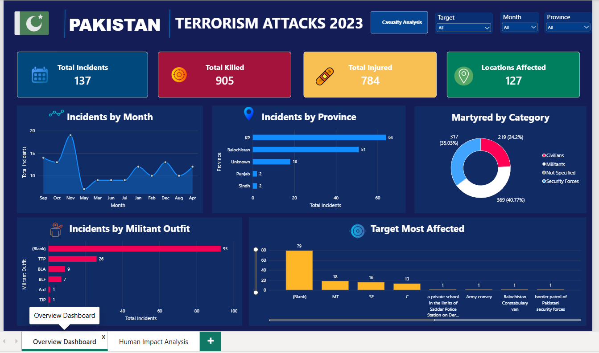
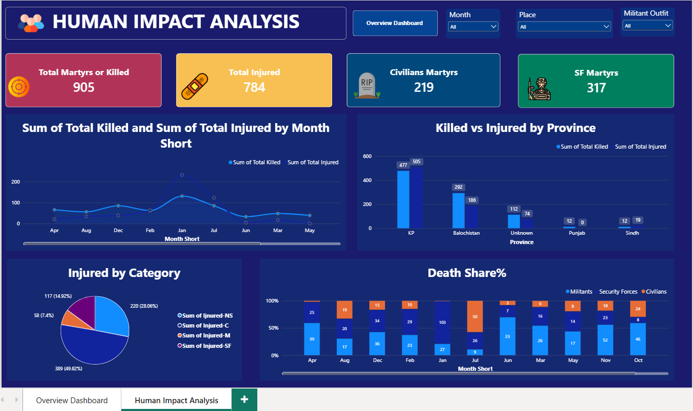

# 🇵🇰 Pakistan Terrorism Analysis | Power BI Dashboard

**Turning incident data into meaningful insights through data visualization.**

## 📌 Project Overview

This project explores terrorism-related incident data in Pakistan through an interactive Power BI dashboard. It focuses on understanding incident patterns, casualties, affected locations, and the distribution of reported fatalities across different categories.

The goal is to transform raw data into clear, structured visual insights that support data exploration and reporting.

## 🎯 Project Objectives

- Analyze incident trends across months.
- Explore locations affected by reported incidents.
- Examine fatalities across civilian, militant, security forces, and unspecified categories.
- Compare total fatalities across different categories.
- Present key metrics through an interactive dashboard.

## 📊 Dashboard Pages

### 1. Overview Dashboard
Provides a high-level summary of incidents, casualties, locations, and other reported patterns.

### 2. Human Impact Analysis
Focuses on reported fatalities and casualty patterns, including:
- Total Killed
- Killed Civilian
- Killed Militants
- Killed Security Forces
- Killed Not Specified
- Monthly Deaths Trend

## 🛠️ Tools & Technologies

- **Microsoft Power BI:** Dashboard development and data visualization
- **Power Query:** Data preparation and transformation
- **Data Visualization:** KPI cards, charts, and interactive slicers

## 🔍 Key Analysis Areas

- Monthly incident trends
- Casualties by category
- Fatality distribution
- Location-based analysis
- Incident and human-impact patterns

## 📷 Dashboard Preview

### Human Impact Analysis

## 🚀 How to Explore

1. Download the `.pbix` file from this repository.
2. Open it using Microsoft Power BI Desktop.
3. Explore the report pages, filters, and visualizations.

The analysis depends on the accuracy, completeness, definitions, and reporting practices of the original dataset. Missing or unspecified records may affect the interpretation of results. This dashboard presents reported data and should not be interpreted as a complete account of every incident.

## 💡 What I Learned

- Preparing and organizing data for analysis
- Building KPI cards and interactive dashboards
- Comparing incident and casualty patterns
- Designing report pages for different analytical purposes
- Communicating findings through data visualization

## 👨‍💻 Author

**Mohammad Tayyab Mehdi**

Aspiring Data Analyst | Power BI | Excel | SQL | Python

---

⭐ If you find this project useful, feel free to explore the repository and share your feedback.
